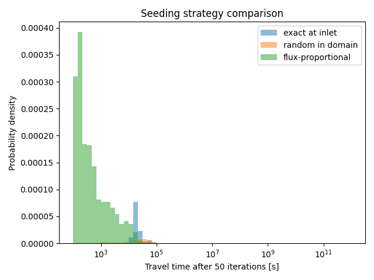

.. _example15:

Example 15 - Comparing Particle Seeding Strategies with Travel Times
====================================================================

In this example, we will route tracer particles through the same flow field three times, differing only in how the particles are seeded, and compare the resulting travel-time statistics. dorado currently offers three ways to seed particles:

1. ``method='exact'`` in :obj:`dorado.particle_track.generate_particles`, which distributes particles across a list of exact seed locations,
2. ``method='random'`` in :obj:`dorado.particle_track.generate_particles`, which picks seed cells at random from the supplied coordinate lists, and
3. :obj:`dorado.particle_track.flux_proportional_seeding`, which computes a release schedule that seeds a given number of particles across a routing window in proportion to the discharge in each timestep.

The choice of seeding strategy determines *which part of the flow field a travel-time measurement describes*: particles seeded at the inlet sample transit through the jet, while particles scattered over the whole domain sample the field as a whole, including its stagnant areas. This example makes that difference concrete by measuring the travel-time distributions of all three strategies over the same field.

The flow field
--------------

The flow field is derived from a short `pyDeltaRCM` simulation: a 100 x 200 cell domain at 50 m/cell resolution, run for 10 updates with a fixed random seed. After 10 updates the delta consists of a central jet of fast flow discharging into an ocean basin, with nearly-stagnant sheet flow over the alluvial plain around it:

===============  ===========  =====================================================
Parameter        Value        Notes
===============  ===========  =====================================================
seed             14           pyDeltaRCM random seed, for reproducibility
Length, Width    5000, 10000  m; 100 x 200 cells
dx               50           m/cell
N0_meters        250          m; a 5-cell-wide inlet at columns 98-102 of row 0
u0, h0           1.0, 5.0     m/s and m, inlet velocity and depth
updates          10           model updates before export
===============  ===========  =====================================================

The final-timestep fields were exported from the pyDeltaRCM NetCDF output and saved to the npz file shipped with this example. The conversion (which only renames the discharge components, since pyDeltaRCM stores them as ``discharge_x``/``discharge_y`` while dorado expects ``qx``/``qy``) is:

.. code-block:: python

   import numpy as np
   from netCDF4 import Dataset

   ds = Dataset('pyDeltaRCM_output.nc', 'r')
   fields = {'depth': np.asarray(ds['depth'][-1], dtype=np.float32),
             'stage': np.asarray(ds['stage'][-1], dtype=np.float32),
             'qx': np.asarray(ds['discharge_x'][-1], dtype=np.float32),
             'qy': np.asarray(ds['discharge_y'][-1], dtype=np.float32)}
   ds.close()
   np.savez('ex_seeding_strategies_data.npz', **fields)

Shortened parameter initialization (for the full code refer to the :download:`example script <../../../examples/traveltime_seeding_strategies.py>`):

.. doctest::

   >>> import numpy as np
   >>> import dorado.particle_track as pt

   >>> params = pt.modelParams()
   >>> params.depth = depth        # from the shipped npz
   >>> params.stage = stage
   >>> params.qx = qx
   >>> params.qy = qy
   >>> params.dx = 50.
   >>> params.theta = 1.0
   >>> params.model = 'DeltaRCM'

The three seeding strategies
----------------------------

We route 1000 particles for 50 iterations with each strategy. The random seed for the whole script is fixed with ``np.random.seed(0)`` at the top; dorado does not expose per-object seeding, so the global numpy seed is what makes runs of this example reproducible.

For the first strategy, all 1000 particles are seeded on the five inlet cells (just downstream of them, in row 2), using ``method='exact'`` with one x-location and the five inlet y-locations:

.. doctest::

   >>> inlet_particles.generate_particles(Np_tracer, seed_xloc, seed_yloc,
   ...                                    method='exact')
   >>> for _ in range(num_iter):
   ...     walk_data = inlet_particles.run_iteration()

For the second strategy, particles are seeded with ``method='random'`` with the full row and column ranges supplied, scattering them uniformly over the whole domain. Note that a few percent of the cells in this field are dry, so a small number of particles are seeded on cells with no water and simply stay in place for the whole routing window:

.. doctest::

   >>> random_particles.generate_particles(Np_tracer, list(range(L)),
   ...                                     list(range(W)), method='random')
   >>> for _ in range(num_iter):
   ...     walk_data = random_particles.run_iteration()

For the third strategy, :obj:`dorado.particle_track.flux_proportional_seeding` distributes the 1000 particles across the 50 routing iterations in proportion to the discharge in each timestep. The discharge of this steady field is constant, so the result is a uniform release schedule of 20 particles per iteration, seeded at the inlet like the first strategy:

.. doctest::

   >>> Q = np.array([np.mean(speed[depth > 0])] * num_iter)
   >>> counts = pt.flux_proportional_seeding(Q, Np_tracer, num_iter)
   >>> for step in range(num_iter):
   ...     flux_particles.generate_particles(int(counts[step]), seed_xloc,
   ...                                       seed_yloc, method='exact')
   ...     walk_flux = flux_particles.run_iteration()

Results
-------

After routing, the script reads the final accumulated travel time of every particle from ``walk_data['travel_times']``, and uses :obj:`dorado.particle_track.exposure_time` to measure the time each particle spent in the ocean basin (defined here as the lower half of the domain). The script prints the following table, which is the actual output of the committed run:

.. code-block:: text

   Travel-time statistics by seeding strategy (N = 1000 particles, 50 iterations)
   strategy           |    p10 [s]    p50 [s]    p90 [s] |  p50 basin [s]
   ------------------------------------------------------------------------
   exact at inlet     |    15461.0    20425.5    55187.7 |            0.0
   random in domain   |    17243.0 1658524783.2 99546507786.8 |         9271.7
   flux-proportional  |      380.0     7393.2    21205.3 |            0.0

The three distributions are clearly distinct, and each has a physical reading:

* **exact at inlet** samples jet transit: every particle rides the central jet, with a median travel time of about 2.0e4 s. None of the particles reach the lower half of the domain within 50 iterations, so the median basin exposure is 0.
* **random in domain** samples the field as a whole, and the result is dominated by stagnation: most particles land on the nearly-stagnant plain or in the still ocean, where velocities are as small as 1e-3 m/s and below. Because the travel time of a step is the distance traveled divided by the average velocity, single cell-crossings on those cells accumulate 1e9-1e11 s. Only the fast tail of the distribution (p10 = 1.7e4 s, matching the jet transit scale) describes transport. Domain-wide random seeding should therefore be read as sampling *where transport is slow*, not as a transit-time measurement.
* **flux-proportional** seeds the same inlet cells as the first strategy, but spreads the releases across the routing window. Under steady discharge this reduces to a uniform release schedule, so the distribution is compressed relative to the first strategy (median 7.4e3 s vs 2.0e4 s): late releases simply have had less time to travel when the window closes.

The histograms of the three distributions span several orders of magnitude and are plotted on a logarithmic axis:

Reproducibility
---------------

dorado does not expose per-object seeding, so this example fixes the global numpy seed with ``np.random.seed(0)`` and routes serially. The script prints a digest of the statistic arrays so that runs can be compared against each other; running the script twice produced byte-identical output with the digest ``9afdd9d701318461`` in both runs.
